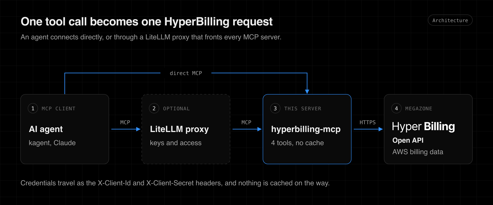

# hyperbilling-mcp

[](https://github.com/kattler/hyperbilling-mcp/pkgs/container/hyperbilling-mcp)
[](https://github.com/kattler/hyperbilling-mcp/pkgs/container/charts%2Fhyperbilling-mcp)
[](https://www.rust-lang.org/)
[](LICENSE)

A Model Context Protocol server that exposes the Megazone HyperBilling Open API as read-only tools, so an agent can answer AWS cost questions from billing data. One tool call is one HyperBilling request.



Diagram source: [architecture.svg](docs/assets/architecture.svg).

## Features

- **[Four read-only tools](docs/tools.md)**: Linked accounts, tag keys, custom billing queries, and seven fixed recent reports.
- **[Custom queries](docs/tools.md#hyperbilling_search_billing)**: Any period, up to five grouping dimensions including tags, region and service filters, and pagination.
- **[Caller credentials](docs/authentication.md)**: Each caller's own HyperBilling headers are forwarded, with an optional fallback credential.
- **[Key safety](docs/authentication.md#key-handling)**: The API key is never logged, and it is stripped from every error the agent sees.
- **[LiteLLM ready](docs/litellm.md)**: Register once on a LiteLLM proxy and serve every model and client behind it.
- **[Built-in documentation](docs/documentation-page.md)**: A page at `/docs` in English and Korean that follows the browser theme and language.
- **[Observability](docs/metrics.md)**: Prometheus metrics for tool calls, latency, and API requests on a separate port.
- **[Helm chart](docs/installation.md)**: Schema-validated values, ServiceMonitor, and extra manifests such as a NetworkPolicy.
- **[Small and hardened](docs/installation.md#container)**: A scratch image of about 5 MB for amd64 and arm64, non-root with a read-only filesystem.
- **[Gated releases](docs/releasing.md)**: Tests, coverage, and a vulnerability scan that blocks any critical or high finding.

## Quick start

The recommended way to install on Kubernetes is the Helm chart, published as an [OCI](https://opencontainers.org/) artifact on GHCR.

```console
helm install hyperbilling-mcp oci://ghcr.io/kattler/charts/hyperbilling-mcp \
  --namespace kagent \
  --set hyperbilling.clientId=user@example.com \
  --set hyperbilling.existingSecret=hyperbilling-mcp
```

The MCP endpoint is `http://hyperbilling-mcp.<namespace>:8080/mcp`, and the server documents itself at `/docs` in English and Korean.

## Documentation

- [Tools](docs/tools.md)
- [Authentication](docs/authentication.md)
- [Installation](docs/installation.md)
- [Configuration](docs/configuration.md)
- [LiteLLM](docs/litellm.md)
- [Documentation page](docs/documentation-page.md)
- [Metrics](docs/metrics.md)
- [Development](docs/development.md)
- [Releasing](docs/releasing.md)
- [Chart values](charts/hyperbilling-mcp/README.md)
- [Changelog](CHANGELOG.md)

## License

Apache License 2.0. See [LICENSE](LICENSE).

This is an unofficial tool, not affiliated with or endorsed by MegazoneCloud. HyperBilling and its logo are trademarks of their owner, used here only to name the service the tools call.
